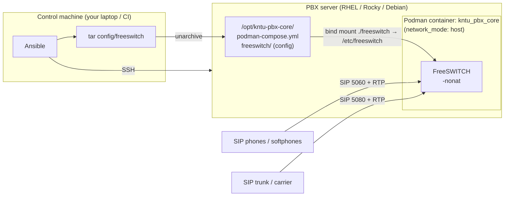

# KNTU PBX

A FreeSWITCH-based IP-PBX. It runs in a Podman container and is deployed with Ansible.

The repository holds three things:

- **The full FreeSWITCH configuration** (`config/freeswitch`). It starts from the stock FreeSWITCH 1.10 "vanilla" config and adds the project's own changes.
- **Ansible playbooks** (`Ansible/`). One prepares a server; the other ships the config and (re)starts the PBX container.
- **Custom call scenarios**: sequential hunting with call confirmation, permanent conference rooms, and an "emergency meeting" conference that dials out to everyone.

> **Status:** early stage / lab setup. The config still uses FreeSWITCH demo defaults, including the SIP password `1234` and the event-socket password `ClueCon`. Read [Security](docs/DOCUMENTATION.md#11-security-hardening) before exposing the server to any network you don't control.

---

## Contents

- [Architecture](#architecture)
- [Repository layout](#repository-layout)
- [Quick start](#quick-start)
- [Dial plan cheat sheet](#dial-plan-cheat-sheet)
- [Common operations](#common-operations)
- [Known issues](#known-issues)
- [Full documentation](#full-documentation)

---

## Architecture



- **Image:** `docker.io/safarov/freeswitch:latest`
- **Networking:** `host`. FreeSWITCH binds straight to the server's interfaces, so no port mapping is needed and RTP works without NAT tricks.
- **Config:** bind-mounted from `/opt/kntu-pbx-core/freeswitch` to `/etc/freeswitch` in the container.
- **NAT:** FreeSWITCH starts with `-nonat`, which turns off UPnP/NAT-PMP port opening on the router.

## Repository layout

```
kntu-pbx/
├── Ansible/
│   ├── files/
│   │   └── podman-compose.yml        # container definition shipped to the server
│   ├── inventory/
│   │   ├── infrastructure.yml        # inventory template for server preparation
│   │   └── pbx.yml                   # inventory template for PBX deployment
│   └── playbook/
│       ├── infrastructure.yml        # installs podman + podman-compose (Debian & RHEL)
│       └── deploy_pbx.yml            # ships config, (re)starts the PBX container
├── config/
│   └── freeswitch/                   # complete /etc/freeswitch tree
│       ├── freeswitch.xml            # root config, includes everything else
│       ├── vars.xml                  # global variables (passwords, domain, codecs, ports)
│       ├── autoload_configs/         # per-module config (modules.conf.xml, sofia, conference, …)
│       ├── sip_profiles/             # internal (5060) and external (5080) SIP profiles
│       ├── directory/default/        # SIP users 1000–1019 (+ demo users)
│       └── dialplan/
│           ├── default.xml           # "default" context (stock demo extensions)
│           ├── default/              # ← project-specific extensions live here
│           │   ├── 01_sequential.xml # 2222: sequential hunt 1001→1002→1003
│           │   └── 02_conference.xml # 30xx rooms, 3100 auto-dial-out meeting
│           └── public.xml            # "public" context (unauthenticated / trunk calls)
├── docs/
│   └── DOCUMENTATION.md              # full technical documentation
└── README.md
```

## Quick start

### 1. Prerequisites

On the **control machine**:

- Ansible 2.12+ (`ansible-core`)
- `sshpass` if you log in with a password instead of an SSH key
- `tar`

On the **PBX server**:

- RHEL / Rocky / Alma / CentOS Stream (needed by `deploy_pbx.yml`, which uses `dnf`). Debian/Ubuntu works for `infrastructure.yml` only; see [Known issues](#known-issues).
- SSH access as root or as a sudo user
- Internet access to pull the container image

### 2. Fill in the inventory

The inventory files hold `{{ … }}` **placeholders**. Ansible does not template them, so they are not valid YAML as committed. Replace them with real values:

```yaml
# Ansible/inventory/pbx.yml
all:
  children:
    pbx_servers:
      hosts:
        server1:
          ansible_host: 203.0.113.10
          ansible_user: root
          # prefer SSH keys; if you must use passwords, keep them in an Ansible Vault file
          # ansible_password: "{{ vault_ansible_password }}"
          # ansible_become_pass: "{{ vault_become_pass }}"
```

### 3. Prepare the server (installs Podman)

```bash
ansible-playbook -i Ansible/inventory/pbx.yml Ansible/playbook/infrastructure.yml
```

### 4. Deploy the PBX

```bash
ansible-playbook -i Ansible/inventory/pbx.yml Ansible/playbook/deploy_pbx.yml
```

Run this again whenever you change anything under `config/freeswitch`. It stops the container, ships the new config and starts it again.

### 5. Open the firewall

| Port | Proto | Purpose |
|------|-------|---------|
| 5060 | UDP/TCP | SIP, internal profile (phones register here) |
| 5080 | UDP/TCP | SIP, external profile (trunks / inbound DIDs) |
| 16384–32768 | UDP | RTP media (FreeSWITCH default range) |
| 5066 / 7443 | TCP | SIP over WebSocket / secure WebSocket (WebRTC) |
| 8081 / 8082 | TCP | Verto (WebRTC) ws / wss |
| **8021** | TCP | Event Socket. **Do not expose.** Block it from the outside. |

### 6. Register a phone

Point any SIP softphone (Zoiper, Linphone, MicroSIP, …) at the server:

| Field | Value |
|-------|-------|
| Username / Auth ID | `1001` (any of `1000`–`1019`) |
| Password | `1234` (`default_password` in `vars.xml`; **change it**) |
| Domain / Server | server IP, port `5060` |

Call `9196` (echo test) to check that audio works.

## Dial plan cheat sheet

| Number | What happens | Defined in |
|--------|--------------|------------|
| `1000`–`1019` | Call an extension; voicemail after 30 s | `dialplan/default.xml` (stock) |
| `2222` | **Sequential hunt:** rings 1001, then 1002, then 1003, 15 s each. The callee must press **1** to accept the call. | `dialplan/default/01_sequential.xml` |
| `3000`–`3099` | **Conference rooms.** Callers dialing the same number land in the same room. | `dialplan/default/02_conference.xml` ⚠️ |
| `3100` | **Emergency meeting:** joins conference 3100 and auto-dials 1001, 1002 and 1003 into it | `dialplan/default/02_conference.xml` ⚠️ |
| `4000` / `*98` | Voicemail main menu | stock |
| `5000` | Demo IVR | stock |
| `9196` | Echo test | stock |
| `9664` | Music on hold | stock |

⚠️ These extensions are currently **shadowed by stock extensions**, so they never run. See [Known issues](#known-issues).

## Common operations

```bash
# FreeSWITCH CLI inside the container
podman exec -it kntu_pbx_core fs_cli

# container status / logs
podman ps -f name=kntu_pbx_core
podman logs -f kntu_pbx_core
```

Useful `fs_cli` commands:

```
reloadxml                       # re-read XML after editing config (dialplan, directory)
sofia status                    # SIP profiles and their state
sofia status profile internal reg   # who is registered
show calls                      # active calls
conference list                 # active conferences
sofia loglevel all 9            # SIP debugging (sofia global siptrace on)
```

## Known issues

These are found in the current config. Details and fixes are in the [full documentation](docs/DOCUMENTATION.md#12-known-issues--recommended-fixes).

1. **The `30xx` and `3100` custom extensions never match.** `dialplan/default.xml` includes `default/*.xml` near the *end* of the context, after the stock `nb_conferences` (`^(30\d{2})$`) and `wb_conferences` (`^(31\d{2})$`) extensions. Dialing `3100` currently opens a plain wideband conference and dials no one out.
2. **Event Socket is open to the world.** It listens on `::` port 8021 with the default password `ClueCon`, and host networking puts that on the public interface.
3. **Demo credentials.** All 20 users share the SIP password `1234`.
4. **Malformed line in `vars.xml`.** The `default_password` line is missing its closing `/>`.
5. **`deploy_pbx.yml` only works on RHEL-family hosts.** It uses `dnf`, while `infrastructure.yml` also supports Debian.
6. **Inventory files are not valid YAML until you fill them in.** Unquoted `{{ … }}` placeholders.
7. **Unused variables.** `project_dir`, `freeswitch_version` and `pwsh_version` in `pbx.yml` are never used. The image tag is `latest`, and the path `/opt/kntu-pbx-core` is hard-coded.

## Full documentation

See **[docs/DOCUMENTATION.md](docs/DOCUMENTATION.md)**. It covers deployment internals, how the FreeSWITCH config is loaded, SIP profiles, users, each call scenario step by step, operations, adding users and extensions, security hardening and troubleshooting.
