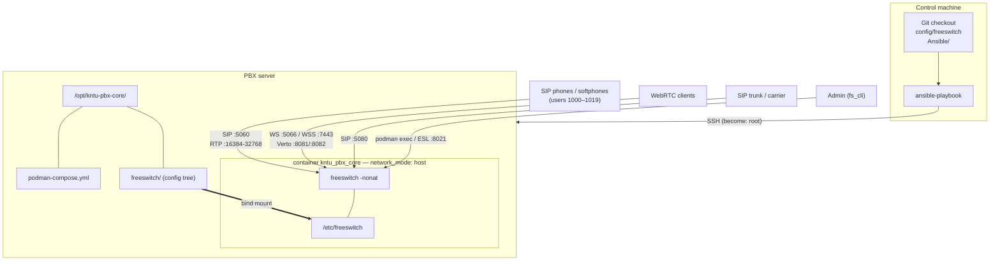
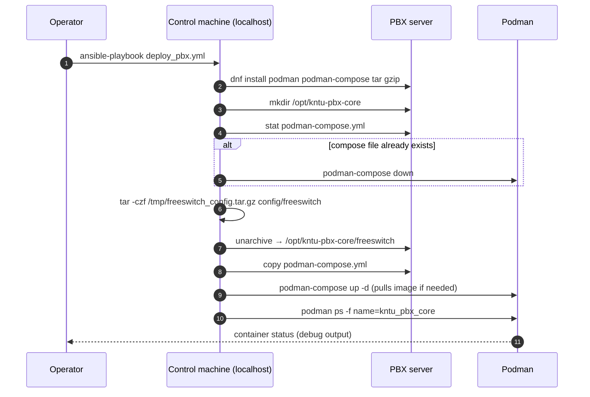
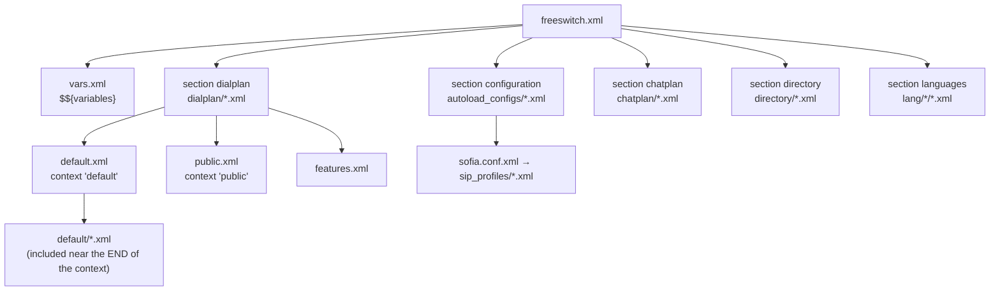
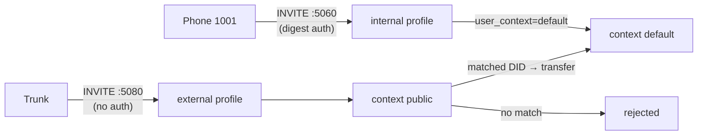
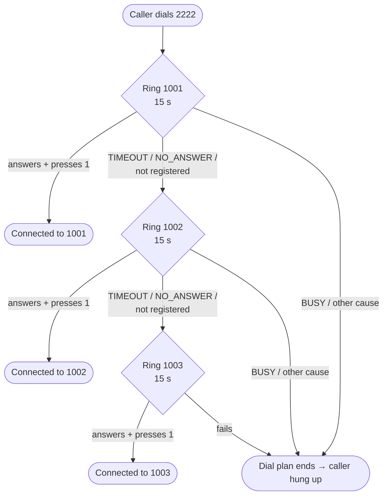
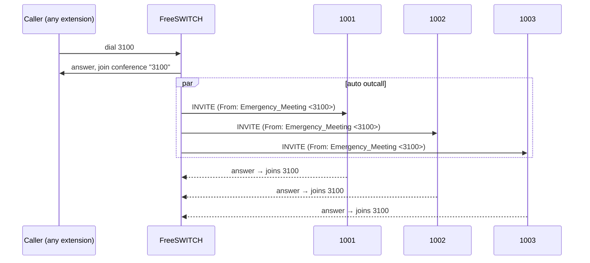

# KNTU PBX — Technical Documentation

This document covers how the KNTU PBX is built, deployed, configured and run. It describes what the repository does today, including what is broken. Every statement is taken from the files in this repository.

---

## Table of contents

1. [Overview](#1-overview)
2. [Architecture](#2-architecture)
3. [Repository layout](#3-repository-layout)
4. [Prerequisites](#4-prerequisites)
5. [Deployment with Ansible](#5-deployment-with-ansible)
6. [Container runtime](#6-container-runtime)
7. [FreeSWITCH configuration](#7-freeswitch-configuration)
8. [Custom call scenarios](#8-custom-call-scenarios)
9. [Operations](#9-operations)
10. [Extending the PBX](#10-extending-the-pbx)
11. [Security hardening](#11-security-hardening)
12. [Known issues & recommended fixes](#12-known-issues--recommended-fixes)
13. [Troubleshooting](#13-troubleshooting)
14. [Reference](#14-reference)

---

## 1. Overview

KNTU PBX is a telephone exchange built on **[FreeSWITCH](https://freeswitch.org/)**. The design has three parts:

| Concern | Choice |
|---------|--------|
| Telephony engine | FreeSWITCH 1.10.x (container image `docker.io/safarov/freeswitch:latest`) |
| Runtime | Podman + podman-compose, one container, host networking |
| Configuration | Full XML config tree kept in Git (`config/freeswitch`) |
| Deployment | Ansible: a server-prep playbook and an idempotent-ish deploy playbook |

The FreeSWITCH config started as the stock **vanilla** configuration (demo users, demo dial plan, all the default modules). The project then adds its own changes on top:

- `vars.xml`: adds `disable_system_api_commands=true`
- `dialplan/default/01_sequential.xml`: sequential hunt group on **2222**
- `dialplan/default/02_conference.xml`: conference rooms **3000–3099** and a dial-out "emergency meeting" on **3100**

Everything else under `config/freeswitch` is upstream default config. `vars.xml.orig` holds the untouched original `vars.xml` for comparison. FreeSWITCH does not load it.

---

## 2. Architecture

### 2.1 Component view



### 2.2 Why host networking

SIP signalling carries IP addresses and ports inside the message body (SDP). A thousand RTP ports also have to be reachable. With `network_mode: host`, FreeSWITCH sees the server's real IP addresses, so `local_ip_v4` resolves correctly. No port mapping or Podman NAT sits in the media path. The cost: **every port FreeSWITCH opens is open on the host**, including the event socket (see [§11](#11-security-hardening)).

### 2.3 Deployment flow



---

## 3. Repository layout

```
kntu-pbx/
├── .gitignore                         # ignores *.retry, ansible.log, secrets.yml, *.key, *.pem, .env
├── README.md
├── docs/DOCUMENTATION.md              # this file
├── Ansible/
│   ├── files/podman-compose.yml       # container definition
│   ├── inventory/
│   │   ├── infrastructure.yml         # host + user placeholders
│   │   └── pbx.yml                    # host, user, passwords placeholders + (unused) vars
│   └── playbook/
│       ├── infrastructure.yml         # install Podman stack (Debian + RHEL)
│       └── deploy_pbx.yml             # ship config & (re)start container (RHEL only)
└── config/freeswitch/                 # mounted as /etc/freeswitch
    ├── freeswitch.xml                 # root document
    ├── vars.xml                       # global pre-processor variables   (modified)
    ├── vars.xml.orig                  # pristine copy, not loaded
    ├── autoload_configs/              # one file per module (*.conf.xml)
    ├── sip_profiles/                  # internal.xml, external.xml (+ ipv6 variants)
    ├── directory/                     # user directory (default domain)
    ├── dialplan/
    │   ├── default.xml                # "default" context
    │   ├── default/                   # included into the default context
    │   │   ├── 00_pizza_demo.xml          (stock)
    │   │   ├── 01_example.com.xml         (stock)
    │   │   ├── 01_Talking_Clock.xml       (stock)
    │   │   ├── 01_sequential.xml          (project)
    │   │   └── 02_conference.xml          (project)
    │   ├── public.xml                 # "public" context (unauthenticated inbound)
    │   ├── public/00_inbound_did.xml  # DID 5551212 → 1000 (stock example)
    │   ├── features.xml               # helper context for in-call features
    │   └── skinny-patterns*.xml       # Cisco SCCP dial plan (stock)
    ├── chatplan/                      # SIP MESSAGE routing
    ├── ivr_menus/                     # demo IVRs
    ├── lang/                          # phrase macros (en, de, es, fr, he, pt, ru, sv)
    └── *.tpl, *.ttml, mime.types …    # voicemail e-mail templates, tone files
```

---

## 4. Prerequisites

### 4.1 Control machine

| Requirement | Notes |
|-------------|-------|
| Ansible (ansible-core ≥ 2.12) | Uses only `ansible.builtin` modules |
| `tar` | The deploy playbook runs `tar` locally (`delegate_to: localhost`) |
| `sshpass` | Only needed for password-based SSH (`ansible_password`) |
| Write access to `/tmp` | The config archive is written to `/tmp/freeswitch_config.tar.gz` |

### 4.2 PBX server

| Requirement | Notes |
|-------------|-------|
| OS | **RHEL-family** (Rocky, Alma, RHEL, CentOS Stream) for `deploy_pbx.yml`. `infrastructure.yml` also supports Debian/Ubuntu. |
| Privileges | Root or a sudoer (`become: true`) |
| Network | Outbound HTTPS to `docker.io` for the image pull. Outbound UDP 3478 to `stun.freeswitch.org` (used by `vars.xml` to find the public IP). |
| Resources | FreeSWITCH is light: 1 vCPU / 1 GB RAM is fine for a lab. Size up for transcoding or large conferences. |

---

## 5. Deployment with Ansible

### 5.1 Inventory

Both inventory files define one group, `pbx_servers`, with one host, `server1`.

`Ansible/inventory/pbx.yml` (as committed):

```yaml
all:
  children:
    pbx_servers:
      hosts:
        server1:
          ansible_host: {{ ansible_host }} # sample 217.60.5.27
          ansible_user: {{ ansible_user }} # sample root
          ansible_password: {{ ansible_password }}
          ansible_become_pass: {{ ansible_become_pass }}
      vars:
        project_dir: "/opt/kntu-pbx"
        freeswitch_version: "1.10.11"
        pwsh_version: "7.4.2"
```

> ⚠️ The `{{ … }}` values are **placeholders for a human to fill in**. Ansible does not render Jinja in inventory files. As committed, the files are not even valid YAML, because an unquoted `{` starts a YAML flow mapping. Replace them before running anything.

A good filled-in inventory keeps secrets out of Git:

```yaml
# Ansible/inventory/pbx.yml
all:
  children:
    pbx_servers:
      hosts:
        server1:
          ansible_host: 203.0.113.10
          ansible_user: deploy
          ansible_become_pass: "{{ vault_become_pass }}"
```

```bash
# Ansible/inventory/group_vars/pbx_servers/secrets.yml  (git-ignored by name)
ansible-vault create Ansible/inventory/group_vars/pbx_servers/secrets.yml
```

`infrastructure.yml` is the same inventory without the password lines. Either file works with either playbook, because both target `hosts: pbx_servers`.

The variables `project_dir`, `freeswitch_version` and `pwsh_version` are **not used by any playbook**. The deploy path is hard-coded to `/opt/kntu-pbx-core`, and the image tag is `latest`.

### 5.2 Playbook: `infrastructure.yml`: prepare the server

```bash
ansible-playbook -i Ansible/inventory/pbx.yml Ansible/playbook/infrastructure.yml
```

| # | Task | Details |
|---|------|---------|
| 1 | Install Podman (Debian/Ubuntu) | `apt`: `podman`, `podman-compose`, `slirp4netns`, `fuse-overlayfs`; refreshes the cache if it is older than 1 h. Only when `os_family == Debian`. |
| 2 | Install Podman (RHEL/CentOS) | `dnf`: same packages, `update_cache: true`. Only when `os_family == RedHat`. |
| 3 | Verify Podman | `podman --version` (read-only, `changed_when: false`) |
| 4 | Verify podman-compose | `podman-compose --version` |
| 5 | Print versions | `debug` message with both versions |

On RHEL 8/9, `podman-compose` comes from **EPEL**. Enable it first (`dnf install epel-release`) or task 2 fails.

### 5.3 Playbook: `deploy_pbx.yml`: ship config and (re)start

```bash
ansible-playbook -i Ansible/inventory/pbx.yml Ansible/playbook/deploy_pbx.yml
```

| # | Task | Runs on | Details |
|---|------|---------|---------|
| 1 | Ensure packages | server | `dnf`: `podman`, `podman-compose`, `tar`, `gzip`. **RHEL-family only.** |
| 2 | Create directory | server | `/opt/kntu-pbx-core`, mode `0755` |
| 3 | Check old compose file | server | `stat /opt/kntu-pbx-core/podman-compose.yml` |
| 4 | Tear down | server | `podman-compose down` in `/opt/kntu-pbx-core`, only if task 3 found the file. Reported as *changed* when the output contains `Removing` or `Stopping`. |
| 5 | Compress config | **localhost** | `tar -czf /tmp/freeswitch_config.tar.gz -C {{ playbook_dir }}/../../config freeswitch`. Runs once, without `become`. The path resolves to `<repo>/config`, so you can run the playbook from any working directory. |
| 6 | Send & extract | server | `unarchive` copies the archive and extracts it into `/opt/kntu-pbx-core/`, producing `/opt/kntu-pbx-core/freeswitch/…` owned by `root:root`. |
| 7 | Copy compose file | server | `Ansible/files/podman-compose.yml` → `/opt/kntu-pbx-core/podman-compose.yml` (`0644`) |
| 8 | Start | server | `podman-compose up -d`. Reported as *changed* on `Starting` / `Pulling`. |
| 9 | Status | server | `podman ps -f name=kntu_pbx_core` |
| 10 | Print status | server | `debug` of the `podman ps` output |

**Behaviour to know about:**

- **Every deploy restarts FreeSWITCH**, which drops all active calls. For dial plan or directory changes alone, you can ship the files and run `fs_cli -x reloadxml` instead (see [§9.3](#93-applying-config-changes-without-a-restart)).
- **Deleted files are not deleted on the server.** `unarchive` only adds and overwrites. If you remove `dialplan/default/foo.xml` from Git, the old copy stays in `/opt/kntu-pbx-core/freeswitch` and keeps loading.
- The image is pulled only when it is missing locally. `latest` therefore does **not** auto-update. Run `podman pull docker.io/safarov/freeswitch:latest` (or pin a tag) to upgrade.

### 5.4 Running only part of a deploy

The playbook has no tags yet. To check what would change without applying it:

```bash
ansible-playbook -i Ansible/inventory/pbx.yml Ansible/playbook/deploy_pbx.yml --check --diff
```

`command` tasks are skipped in check mode, so the output is only a partial preview.

---

## 6. Container runtime

`Ansible/files/podman-compose.yml`:

```yaml
version: '3.8'
services:
  freeswitch:
    image: docker.io/safarov/freeswitch:latest
    container_name: kntu_pbx_core
    network_mode: "host"
    restart: unless-stopped
    command: ["freeswitch", "-nonat"]
    volumes:
      - ./freeswitch:/etc/freeswitch
```

| Key | Meaning |
|-----|---------|
| `image` | Community FreeSWITCH image (Debian-based). It reads its config from `/etc/freeswitch`. |
| `container_name` | Fixed name `kntu_pbx_core`; used by `podman exec`, `podman logs` and the status task |
| `network_mode: host` | No network isolation; FreeSWITCH binds directly to host interfaces |
| `restart: unless-stopped` | Restart on crash. With Podman, surviving a **host reboot** also needs a systemd unit (see below). |
| `command` | `freeswitch -nonat`: skip UPnP / NAT-PMP router probing. This is the hardening step recommended in `README_IMPORTANT.txt`. |
| `volumes` | `/opt/kntu-pbx-core/freeswitch` → `/etc/freeswitch` |

**Starting on boot.** Podman has no always-running daemon to honour `restart:` after a reboot. Generate a unit once:

```bash
cd /opt/kntu-pbx-core
podman generate systemd --new --name kntu_pbx_core --files
mv container-kntu_pbx_core.service /etc/systemd/system/
systemctl daemon-reload && systemctl enable container-kntu_pbx_core.service
```

Alternatively, enable `podman-restart.service`, which restarts every container whose policy is `always`.

**SELinux (RHEL family).** If SELinux is enforcing, the container may get *permission denied* reading the bind-mounted config. Add the `:Z` relabel flag to the volume (`./freeswitch:/etc/freeswitch:Z`) or label the directory with `container_file_t`.

**Sound files.** Demo prompts, music on hold and conference sounds need the FreeSWITCH sound packages inside the container. If calls play silence and the log shows `File … not found` for `.wav` sounds, check the image's documentation for how it installs sounds (environment variables or a mounted sounds directory) and add that to the compose file.

---

## 7. FreeSWITCH configuration

### 7.1 How the XML is assembled

FreeSWITCH loads `freeswitch.xml`. A **pre-processor** expands it into one big document before any module reads it:



Rules worth knowing:

- `<X-PRE-PROCESS cmd="set" data="name=value"/>` defines `$${name}`. It is substituted **once, at load time**. In contrast, `${name}` is a channel variable that is evaluated per call.
- `<X-PRE-PROCESS cmd="include" data="glob"/>` inlines files **in alphabetical order** at that exact spot. That is why the custom files are numbered `01_`, `02_`.
- A pre-process line cannot be commented out with `<!-- -->`; delete it or rename the tag (e.g. `XX-PRE-PROCESS`).
- Included fragments should be wrapped in `<include>…</include>` (see [§12.7](#127-dial-plan-fragments-without-include)).

### 7.2 Global variables (`vars.xml`)

The values that matter for this deployment:

| Variable | Value | Effect |
|----------|-------|--------|
| `default_password` | `1234` | SIP password for **every** directory user. The stock `global` extension logs a warning on every call while this is still `1234`. |
| `disable_system_api_commands` | `true` | **Project change.** Turns off the `system` API command, so nobody can run shell commands on the host through fs_cli/ESL. |
| `domain` / `domain_name` | `$${local_ip_v4}` | The SIP domain is the server's primary IPv4 address. Phones register to `1001@<server-ip>`. |
| `sound_prefix` | `$${sounds_dir}/en/us/callie` | Prompt voice |
| `hold_music` | `local_stream://moh` | Music on hold source |
| `global_codec_prefs` / `outbound_codec_prefs` | `OPUS,G722,PCMU,PCMA,H264,VP8` | Codec negotiation order |
| `external_rtp_ip` / `external_sip_ip` | `stun:stun.freeswitch.org` | Public IP found through STUN at startup; written into SDP for NATed peers |
| `internal_sip_port` / `internal_tls_port` | `5060` / `5061` | Internal profile (TLS disabled: `internal_ssl_enable=false`) |
| `external_sip_port` / `external_tls_port` | `5080` / `5081` | External profile (TLS disabled) |
| `internal_auth_calls` | `true` | Phones on 5060 must authenticate |
| `outbound_caller_name` / `outbound_caller_id` | `FreeSWITCH` / `0000000000` | Default outbound caller ID |
| `default_provider*` | `example.com` / `joeuser` / `password` | Placeholder trunk (`directory/default/example.com.xml`), `register=false` |
| `console_loglevel` | `info` | |

To see any computed value at runtime: `fs_cli -x 'eval $${local_ip_v4}'`.

### 7.3 Loaded modules

`autoload_configs/modules.conf.xml` loads the stock set, including:

- **Core / logging:** `mod_console`, `mod_logfile`, `mod_cdr_csv` (CDRs as CSV), `mod_event_socket`
- **Endpoints:** `mod_sofia` (SIP), `mod_loopback`, `mod_rtc`, `mod_verto` (WebRTC), `mod_signalwire`
- **Applications:** `mod_commands`, `mod_conference`, `mod_dptools`, `mod_db`, `mod_expr`, `mod_fifo`, `mod_hash`, `mod_voicemail`, `mod_esf`, `mod_fsv`, `mod_valet_parking`, `mod_httapi`
- **Dial plan:** `mod_dialplan_xml`, `mod_dialplan_asterisk`
- **Codecs:** `mod_spandsp`, `mod_g723_1`, `mod_g729`, `mod_amr`, `mod_b64`, `mod_opus`, `mod_av`, `mod_png`
- **Formats / streams:** `mod_sndfile`, `mod_native_file`, `mod_local_stream`, `mod_tone_stream`
- **Scripting / say:** `mod_lua`, `mod_say_en`

`mod_signalwire` is not needed for a private PBX. Comment it out if you don't use SignalWire.

### 7.4 SIP profiles

| Profile | File | Port | Auth | Context | Used by |
|---------|------|------|------|---------|---------|
| `internal` | `sip_profiles/internal.xml` | 5060 (TLS 5061, off) | `auth-calls=true`; ACL `domains` | `public`, but authenticated users jump to their `user_context` = `default` | Phones / softphones |
| `external` | `sip_profiles/external.xml` | 5080 (TLS 5081, off) | `auth-calls=false` | `public` | Trunks, carriers, inbound DIDs |

The internal profile also opens SIP over WebSocket on **5066** (ws) and **7443** (wss). `mod_verto` listens on **8081** (ws) and **8082** (wss).

How a call is routed:



The `public` context **cannot** reach extensions or outside lines directly. It only reaches what `dialplan/public/*.xml` explicitly transfers into `default`. The only stock rule maps DID `5551212` to extension `1000`.

### 7.5 User directory

`directory/default.xml` defines the domain `$${domain}` (the server IP) and includes `directory/default/*.xml`:

| User(s) | Password | Voicemail PIN | Notes |
|---------|----------|---------------|-------|
| `1000`–`1019` | `$${default_password}` (= `1234`) | same as the extension number | `user_context=default`, `toll_allow=domestic,international,local`; caller-ID name `Extension 10xx`. Each has a `callgroup` (e.g. `1001` → `techsupport`). |
| `brian` | `$${default_password}` | `9999` | Demo user, IP-auth from `192.0.2.0/24` |
| `example.com` | — | — | Gateway (trunk) definition using `default_provider*` vars |
| `skinny-example` | — | — | Cisco SCCP demo device |

### 7.6 Dial plan: the `default` context

FreeSWITCH reads the extensions in a context **from top to bottom**. When an extension's conditions match, its actions are queued. Hunting **stops at the first matching extension that lacks `continue="true"`**. Order therefore decides everything.

Order inside `dialplan/default.xml` (abridged):

| Position | Extension | Pattern | Purpose |
|----------|-----------|---------|---------|
| top | `unloop`, `tod_example`, `holiday_example`, `global` … | — | Housekeeping (`continue="true"`) |
| | `Local_Extension` | `^(10[01][0-9])$` | Ring the user 30 s, then voicemail |
| | `group_dial_*` | `2000`, `2001`, `2002` | Ring call groups sales / support / billing |
| | `operator`, `vmain` | `0`, `4000`, `*98` | Operator, voicemail |
| | **`nb_conferences`** | **`^(30\d{2})$`** | Narrowband conference `30xx-<domain>@default` |
| | **`wb_conferences`** | **`^(31\d{2})$`** | Wideband conference `31xx-<domain>@wideband` |
| | `uwb_`, `cdquality_*` | `32xx`, `33xx`, `35xx`–`38xx` | More conference profiles |
| | demos | `5000` IVR, `5900`/`5901` park, `9178`–`9198`, `9664` MOH … | Stock demos |
| line ~768 | **`default/*.xml` included here** | | **Project extensions** |
| bottom | `refer`, `ruri`, `7004`, `enum`, `acknowledge_call` | | Fallbacks |

The consequence for the project's conference extensions is covered in [§12.1](#121-conference-extensions-are-shadowed-by-stock-ones).

---

## 8. Custom call scenarios

### 8.1 Sequential hunting with confirmation (2222)

File: `config/freeswitch/dialplan/default/01_sequential.xml`

```xml
<extension name="sequential_hunting_with_confirm">
  <condition field="destination_number" expression="^2222$">
    <action application="set" data="group_confirm_key=1"/>
    <action application="set" data="group_confirm_file=tone_stream://%(200,0,800)"/>
    <action application="set" data="continue_on_fail=TIMEOUT,NO_ANSWER,USER_NOT_REGISTERED"/>
    <action application="set" data="hangup_after_bridge=true"/>
    <action application="bridge" data="[leg_timeout=15]user/1001"/>
    <action application="bridge" data="[leg_timeout=15]user/1002"/>
    <action application="bridge" data="[leg_timeout=15]user/1003"/>
  </condition>
</extension>
```

**What each line does**

| Action | Effect |
|--------|--------|
| `group_confirm_key=1` | When a callee answers, they are **not** connected yet. They must press **1** first. This stops the call from being swallowed by a voicemail box or an accidental answer. |
| `group_confirm_file=tone_stream://%(200,0,800)` | What the callee hears after answering: a 200 ms 800 Hz beep, which prompts them to press 1 |
| `continue_on_fail=TIMEOUT,NO_ANSWER,USER_NOT_REGISTERED` | Move on to the next `bridge` only for these hang-up causes. Any **other** failure (for example `USER_BUSY`) **ends** the hunt. |
| `hangup_after_bridge=true` | Once a bridged call ends, hang up the caller instead of running the next `bridge` |
| `bridge [leg_timeout=15]user/100X` | Ring that user for at most 15 s |

**Flow**



**Testing it**

1. Register `1001`, `1002`, `1003` and a fourth phone (e.g. `1004`).
2. From `1004`, dial `2222`. `1001` rings.
3. Answer on `1001` without pressing anything; you hear a beep. Press `1` and the call connects.
4. Repeat, but let `1001` ring out. After 15 s, `1002` rings.
5. Unregister `1001`. Dialing `2222` now goes straight to `1002`.

**Variants**

- Treat busy as "try the next one": add `USER_BUSY` to `continue_on_fail`.
- Ring everyone at once (simultaneous ring): `bridge` with a comma-separated list, `user/1001,user/1002,user/1003`. The first to answer and press 1 wins.
- Send the call to voicemail at the end: add `<action application="answer"/>` and `<action application="voicemail" data="default ${domain_name} 1001"/>` after the last bridge.

### 8.2 Permanent conference rooms (3000–3099)

File: `config/freeswitch/dialplan/default/02_conference.xml`

```xml
<extension name="permanent_meeting_rooms">
  <condition field="destination_number" expression="^(30\d{2})$">
    <action application="answer"/>
    <action application="conference" data="$1@default"/>
  </condition>
</extension>
```

- `^(30\d{2})$` matches 3000–3099 and captures the number as `$1`.
- `conference $1@default` joins (or creates) a conference named, for example, `3005`, using the `default` profile in `autoload_configs/conference.conf.xml`: 8 kHz, 20 ms frames, MOH while alone, PIN-less.
- Everyone who dials the same number joins the same room. The room exists while at least one member is in it.

In-conference DTMF controls (`caller-controls` group `default` in `conference.conf.xml`):

| Key | Action | Key | Action |
|-----|--------|-----|--------|
| `0` | mute / unmute | `*` | deaf + mute |
| `1` / `2` / `3` | talk volume down / reset / up | `4` / `5` / `6` | listen volume down / reset / up |
| `7` / `8` / `9` | energy threshold down / reset / up | `#` | leave the conference |

> ⚠️ This extension currently **never runs**. See [§12.1](#121-conference-extensions-are-shadowed-by-stock-ones).

### 8.3 Emergency meeting with automatic dial-out (3100)

```xml
<extension name="outbound_blast_dial">
  <condition field="destination_number" expression="^3100$">
    <action application="conference_set_auto_outcall" data="user/1001"/>
    <action application="conference_set_auto_outcall" data="user/1002"/>
    <action application="conference_set_auto_outcall" data="user/1003"/>

    <action application="set" data="conference_auto_outcall_caller_id_name=Emergency_Meeting"/>
    <action application="set" data="conference_auto_outcall_caller_id_number=3100"/>

    <action application="answer"/>
    <action application="conference" data="3100@default"/>
  </condition>
</extension>
```

| Action | Effect |
|--------|--------|
| `conference_set_auto_outcall user/100X` | Adds a dial string to the list FreeSWITCH calls automatically when this caller enters the conference |
| `conference_auto_outcall_caller_id_name/number` | What the called phones display: `Emergency_Meeting` / `3100` |
| `conference 3100@default` | Joins room `3100`, then the auto-outcalls go out in parallel |



Useful extra variables, set before `conference`:

| Variable | Purpose |
|----------|---------|
| `conference_auto_outcall_timeout=60` | Seconds to ring each participant |
| `conference_auto_outcall_flags=mute` | Join the called parties muted (e.g. announcements) |
| `conference_auto_outcall_announce=say:Emergency meeting` | Played to each called party before they join |
| `conference_auto_outcall_profile=default` | Profile used for the outcalls |

The stock `mad_boss_intercom` extensions in `default.xml` (`0911`, `0912`) are a working reference for this pattern.

> ⚠️ This extension currently **never runs**: `3100` is caught by the stock `wb_conferences` extension. See [§12.1](#121-conference-extensions-are-shadowed-by-stock-ones).

---

## 9. Operations

### 9.1 CLI access

```bash
podman exec -it kntu_pbx_core fs_cli          # interactive console (/exit or Ctrl-D to leave)
podman exec kntu_pbx_core fs_cli -x 'status'  # one-shot command
```

### 9.2 Everyday commands

| Command | Purpose |
|---------|---------|
| `status` | Uptime, sessions, sessions/sec |
| `version` | FreeSWITCH version |
| `reloadxml` | Re-read all XML (dial plan, directory, vars) without a restart |
| `reload mod_conference` | Reload one module's config |
| `sofia status` | Profiles, gateways and their state |
| `sofia status profile internal reg` | Registered endpoints |
| `sofia profile internal restart` | Restart a SIP profile (drops its calls) |
| `show channels` / `show calls` | Active channels / bridged calls |
| `uuid_kill <uuid>` | Hang up one call |
| `originate user/1001 &echo` | Make 1001 ring and connect it to the echo app |
| `originate user/1001 2222 XML default` | Ring 1001, then send it into extension 2222 |
| `conference list` | All conferences and members |
| `conference 3005 kick all` | Empty a room |
| `conference 3005 mute <member_id>` | Mute a member |
| `sofia global siptrace on` | Print SIP packets to the console |
| `console loglevel debug` | More verbose console |
| `fsctl shutdown elegant` | Stop after the last call ends |

### 9.3 Applying config changes without a restart

Dial plan and directory edits don't need a container restart:

```bash
# on the control machine: sync only the config
rsync -av --delete config/freeswitch/ root@SERVER:/opt/kntu-pbx-core/freeswitch/
# on the server
podman exec kntu_pbx_core fs_cli -x reloadxml
```

SIP profile changes need `sofia profile <name> restart`. Changes to `modules.conf.xml`, `switch.conf.xml` or `vars.xml` values used by profiles are safest with a full restart: `podman restart kntu_pbx_core` or a re-run of `deploy_pbx.yml`.

### 9.4 Logs & CDRs

| What | Where |
|------|-------|
| Container stdout | `podman logs -f kntu_pbx_core` |
| FreeSWITCH log file | inside the container, normally `/var/log/freeswitch/freeswitch.log` (`fs_cli -x 'eval $${log_dir}'` prints the directory) |
| CDRs | `mod_cdr_csv` writes CSV under `$${log_dir}/cdr-csv/` |
| Recordings | `$${recordings_dir}` (in-call `*2` on `Local_Extension` calls records the session) |

None of these paths are volume-mounted, so **logs, CDRs, voicemail and recordings are lost when the container is re-created**. That happens on every run of `deploy_pbx.yml`, because it does `down` + `up`. Add volumes if you need them to persist:

```yaml
    volumes:
      - ./freeswitch:/etc/freeswitch:Z
      - ./data/log:/var/log/freeswitch:Z
      - ./data/lib:/var/lib/freeswitch:Z     # voicemail db, recordings, storage
```

### 9.5 Health check

```bash
podman exec kntu_pbx_core fs_cli -x 'sofia status' | grep -E 'internal|external'
```

Both profiles should show `RUNNING`.

---

## 10. Extending the PBX

### 10.1 Add a user

1. Copy an existing user: `cp directory/default/1019.xml directory/default/1020.xml`.
2. Edit `id="1020"`, `vm-password`, `accountcode`, `effective_caller_id_*`, and give it a **unique password** instead of `$${default_password}`:
   ```xml
   <param name="password" value="a-long-random-secret"/>
   ```
3. The stock `Local_Extension` pattern only covers `1000`–`1019` (`^(10[01][0-9])$`). Widen it in `dialplan/default.xml` so the new user is reachable, e.g. `^(10[0-9][0-9])$`.
4. Deploy (or rsync + `reloadxml`).

### 10.2 Add a dial plan scenario

1. Create `config/freeswitch/dialplan/default/03_<name>.xml`:
   ```xml
   <include>
     <extension name="my_feature">
       <condition field="destination_number" expression="^2300$">
         <action application="answer"/>
         <action application="playback" data="ivr/ivr-welcome.wav"/>
         <action application="hangup"/>
       </condition>
     </extension>
   </include>
   ```
2. Pick a number **no stock extension above the include already matches** (see the table in [§7.6](#76-dial-plan-the-default-context)). Ranges still free in the stock dial plan include `21xx`–`29xx` (except `2000`–`2002`), `34xx` and `39xx`.
3. `reloadxml`, then test from a registered phone. To see which extension matched, run `console loglevel debug` and look for `Regex (PASS)` lines.

### 10.3 Connect a SIP trunk

1. Create `sip_profiles/external/<provider>.xml`:
   ```xml
   <include>
     <gateway name="provider">
       <param name="username" value="..."/>
       <param name="password" value="..."/>
       <param name="realm" value="sip.provider.example"/>
       <param name="proxy" value="sip.provider.example"/>
       <param name="register" value="true"/>
     </gateway>
   </include>
   ```
2. Inbound: add a DID rule in `dialplan/public/` (copy `00_inbound_did.xml`) that transfers to an extension or to `2222`.
3. Outbound: add an extension in `default/` that bridges to `sofia/gateway/provider/$1`, gated by `${toll_allow}`.
4. `sofia profile external rescan`, then `sofia status gateway provider`.

Keep trunk credentials out of Git: use a git-ignored file, Ansible Vault and a template.

---

## 11. Security hardening

FreeSWITCH's own `README_IMPORTANT.txt` (shipped in `config/freeswitch`) warns that the vanilla config is a demo, not a production setup. On a host with a public IP, **scanners will find a SIP port on 5060 within minutes**. Toll fraud through weak SIP passwords is the most common way a PBX gets abused.

Checklist, most important first:

| # | Item | How |
|---|------|-----|
| 1 | **Lock down the Event Socket** | `autoload_configs/event_socket.conf.xml`: set `listen-ip` to `127.0.0.1`, change `password` from `ClueCon`, and enable `<param name="apply-inbound-acl" value="loopback.auto"/>`. With host networking, ESL on `::` is reachable from the internet and gives **full control** of the PBX. |
| 2 | **Change SIP passwords** | Replace `default_password=1234` in `vars.xml`, or better, give each user a unique random password (§10.1). |
| 3 | **Change voicemail PINs** | Each user's `vm-password` equals the extension number |
| 4 | **Firewall** | Allow 5060/5080 and the RTP range only from known networks. Drop 8021 completely. Close 5066/7443/8081/8082 if you don't use WebRTC. |
| 5 | **fail2ban** | Watch the FreeSWITCH log for `SIP auth failure` and ban the source IP |
| 6 | **Remove demo content** | Unneeded `directory/default/brian.xml`, `example.com.xml`, `skinny-example.xml`, the demo extensions (`9178`–`9198`, `0911`–`0913`, `9888`/`1616`/`3232` public-conf-via-SIP) and `mod_signalwire` |
| 7 | **Restrict outbound** | Before adding a trunk, gate outbound calls on `${toll_allow}` and limit international dialing |
| 8 | **TLS / SRTP** | Set `internal_ssl_enable=true`, provide certificates in `$${certs_dir}`, set `rtp_secure_media=optional` or `mandatory` |
| 9 | **Secrets in Git** | Keep `ansible_password` / `ansible_become_pass` in Ansible Vault (`secrets.yml` is already in `.gitignore`); prefer SSH keys |
| 10 | **Pin the image** | Replace `:latest` with a tested tag or digest |

`disable_system_api_commands=true` is already set, which removes one attack path: shell execution through the `system` API.

---

## 12. Known issues & recommended fixes

### 12.1 Conference extensions are shadowed by stock ones

**Symptom.** Dialing `3005` lands in conference `3005-<server-ip>` (stock), not `3005` (custom). Dialing `3100` opens a plain **wideband** conference and dials **nobody** out.

**Cause.** In `dialplan/default.xml`, `default/*.xml` is included around line 768. The stock extensions `nb_conferences` (`^(30\d{2})$`, line ~328) and `wb_conferences` (`^(31\d{2})$`, line ~335) sit above it. They have no `continue="true"`, so the hunt stops there and `02_conference.xml` is never reached. (`2222` is not affected; nothing above the include matches it.)

**Fix: pick one.**

- **A. Remove the stock extensions (recommended).** Delete the `nb_conferences` and `wb_conferences` blocks from `dialplan/default.xml`. Do the same for any other stock range you want to take over.
- **B. Use free numbers.** For example, rooms on `^(39\d{2})$` and the emergency meeting on `3400`.
- **C. Move the include.** Move `<X-PRE-PROCESS cmd="include" data="default/*.xml"/>` to just after the `global` extension (before `Local_Extension`). Project extensions then take priority over every stock one. Review them carefully, because a broad pattern there would hijack normal extension dialing.

Verify after the change:

```
fs_cli> console loglevel debug
(dial 3100 from a phone)
→ look for: Regex (PASS) [outbound_blast_dial] destination_number(3100) =~ /^3100$/
```

### 12.2 Event Socket exposed with the default password

`listen-ip="::"`, `password="ClueCon"`, the ACL commented out, and host networking. Fix as in [§11](#11-security-hardening), item 1.

### 12.3 Malformed `default_password` line in `vars.xml`

```xml
<X-PRE-PROCESS cmd="set" data="default_password=1234"          <!-- missing />  -->
<X-PRE-PROCESS cmd="set" data="disable_system_api_commands=true"/>
```

The pre-processor reads line by line and will probably still accept it, but the line is malformed. Fix it (and pick a real password while you are there):

```xml
<X-PRE-PROCESS cmd="set" data="default_password=CHANGE-ME"/>
```

### 12.4 `deploy_pbx.yml` is RHEL-only

Task 1 uses `ansible.builtin.dnf`, so the playbook fails on Debian/Ubuntu even though `infrastructure.yml` supports them. Packages are installed by `infrastructure.yml` anyway, so the simplest fix is to drop task 1. Alternatively, switch it to `ansible.builtin.package`, which picks apt or dnf automatically:

```yaml
    - name: Ensure required packages are installed
      ansible.builtin.package:
        name: [podman, podman-compose, tar, gzip]
        state: present
```

### 12.5 Inventory placeholders

`{{ ansible_host }}` and the others are not valid YAML, and Ansible does not template inventory files. Fill them in by hand (see §5.1), or ship an `pbx.example.yml` and git-ignore the real one.

### 12.6 Stale files and unused variables

- `unarchive` never removes files that were deleted from the repo (§5.3). Either delete `/opt/kntu-pbx-core/freeswitch` before extracting, or use `ansible.posix.synchronize` with `delete: true`.
- `project_dir`, `freeswitch_version` and `pwsh_version` are unused. Either wire them in (`image: docker.io/safarov/freeswitch:{{ freeswitch_version }}` via a template, `{{ project_dir }}` instead of the hard-coded path) or delete them.
- The config archive goes to a fixed `/tmp/freeswitch_config.tar.gz` on the control machine. Two parallel deploys would overwrite each other's archive.

### 12.7 Dial plan fragments without `<include>`

`01_sequential.xml` and `02_conference.xml` hold bare `<extension>` elements. The FreeSWITCH convention, also stated in `freeswitch.xml`, is to wrap partial files in `<include>…</include>`, as the stock files in the same directory do. Wrap them to stay consistent and avoid parser surprises:

```xml
<include>
  <extension name="…">…</extension>
</include>
```

### 12.8 No persistence for runtime data

Logs, CDRs, voicemail and recordings live inside the container and are lost on every deploy. See §9.4.

---

## 13. Troubleshooting

| Symptom | Likely cause | Check / fix |
|---------|--------------|-------------|
| Playbook fails parsing the inventory | `{{ … }}` placeholders not replaced | §5.1 |
| `No package podman-compose available` (RHEL) | EPEL not enabled | `dnf install -y epel-release` |
| `dnf` not found (Ubuntu) | `deploy_pbx.yml` is RHEL-only | §12.4 |
| Container exits immediately | XML error in config | `podman logs kntu_pbx_core`; look for `[ERR] … XML` with a file and line |
| `Permission denied` on `/etc/freeswitch` | SELinux label | Add `:Z` to the volume (§6) |
| Phone gets `403 Forbidden` | Wrong password, or the domain does not match the server IP | Use the server's IP as domain; `sofia status profile internal reg`; `sofia global siptrace on` |
| Phone registers but calls fail with `404` / `NO_ROUTE_DESTINATION` | No extension matches | `console loglevel debug`, watch the `Regex` lines |
| One-way or no audio | RTP blocked, or wrong external IP in SDP | Open UDP 16384–32768; `fs_cli -x 'eval $${external_rtp_ip}'`; set a real IP in `vars.xml` instead of STUN if the server has a static public IP |
| `3100` doesn't dial anyone | Shadowed by `wb_conferences` | §12.1 |
| Silence instead of prompts / MOH | Sound files missing in image | §6, "Sound files" |
| Container not back after reboot | Podman has no daemon | systemd unit, §6 |
| Changes "don't apply" | Forgot `reloadxml`, or a stale file still on the server | §9.3, §12.6 |

---

## 14. Reference

### 14.1 Ports

| Port | Proto | Component | Expose? |
|------|-------|-----------|---------|
| 5060 | UDP/TCP | SIP internal profile | Yes (restrict by source if you can) |
| 5061 | TCP | SIP-TLS internal (disabled) | If TLS enabled |
| 5080 | UDP/TCP | SIP external profile | Only to trunk providers |
| 5081 | TCP | SIP-TLS external (disabled) | If TLS enabled |
| 5066 / 7443 | TCP | SIP over WS / WSS | Only if WebRTC used |
| 8081 / 8082 | TCP | Verto WS / WSS | Only if Verto used |
| 16384–32768 | UDP | RTP media | Yes |
| 8021 | TCP | Event Socket (ESL) | **Never** |

### 14.2 Numbers

| Number | Function | Source |
|--------|----------|--------|
| 1000–1019 | Extensions | stock |
| 0 / operator | Operator → transfers to `1000` in the `features` context | stock |
| 2000 / 2001 / 2002 | Call groups sales / support / billing | stock |
| **2222** | Sequential hunt 1001 → 1002 → 1003 with confirm | project |
| **3000–3099** | Permanent rooms (*shadowed*) | project |
| **3100** | Emergency meeting with dial-out (*shadowed*) | project |
| 30xx / 31xx / 32xx / 33xx | Conferences @ 8 / 16 / 32 / 48 kHz | stock |
| 4000 / *98 / vmain | Voicemail | stock |
| 5000 | Demo IVR | stock |
| 5900 / 5901 | Park / unpark | stock |
| 6000, 60xx | Valet parking | stock |
| 9196 | Echo test | stock |
| 9664 | Music on hold | stock |
| 9195 / 9197 / 9198 | Delayed echo / milliwatt / tone stream | stock |
| *69 / 869 | Call return | stock |
| 870 / redial | Redial | stock |
| *8 / **ext | Group / directed pickup | stock |

### 14.3 Further reading

- FreeSWITCH documentation: <https://developer.signalwire.com/freeswitch/>
- XML dial plan: <https://developer.signalwire.com/freeswitch/FreeSWITCH-Explained/Dialplan/XML-Dialplan/>
- `mod_conference`: <https://developer.signalwire.com/freeswitch/FreeSWITCH-Explained/Modules/mod_conference_3965534/>
- Bridge / `continue_on_fail` / `group_confirm`: <https://developer.signalwire.com/freeswitch/FreeSWITCH-Explained/Dialplan/Variables-Master-List/>
- Ansible Vault: <https://docs.ansible.com/ansible/latest/vault_guide/index.html>
- Podman systemd integration: <https://docs.podman.io/en/latest/markdown/podman-generate-systemd.1.html>
